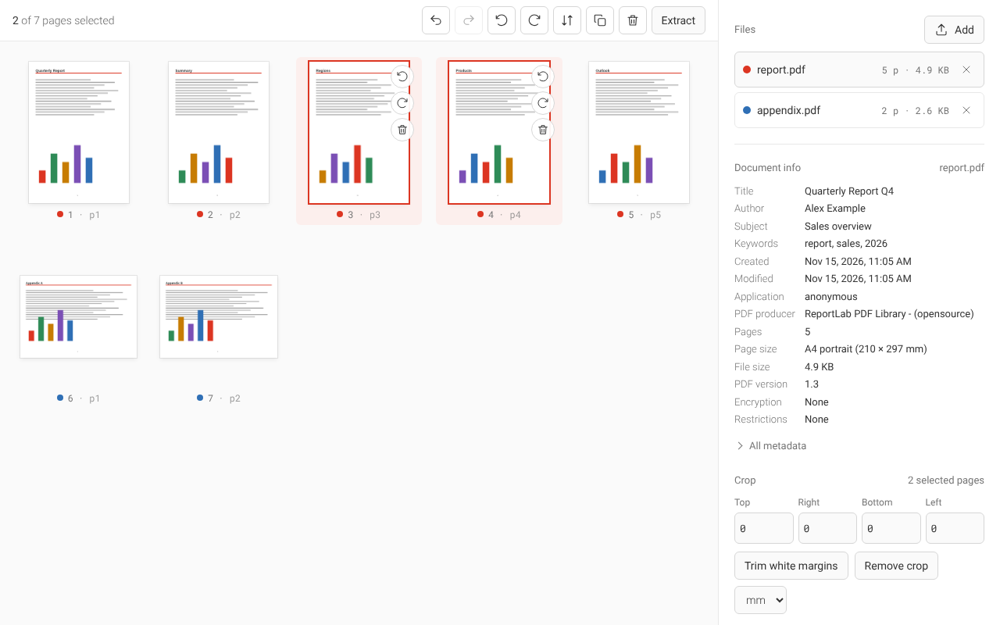

# PDF Toolkit

Drop one or more PDFs to merge them, reorder pages by dragging, rotate, duplicate, delete or crop pages (including automatic white-margin trimming), and split into several files. Password-protected PDFs can be unlocked with their password and saved without encryption or restrictions; output can optionally be protected with a new password. All document metadata (info dictionary, XMP, permissions, encryption, page sizes) is shown and the main fields can be edited. Runs fully in the browser using pdf.js and pdf-lib.
