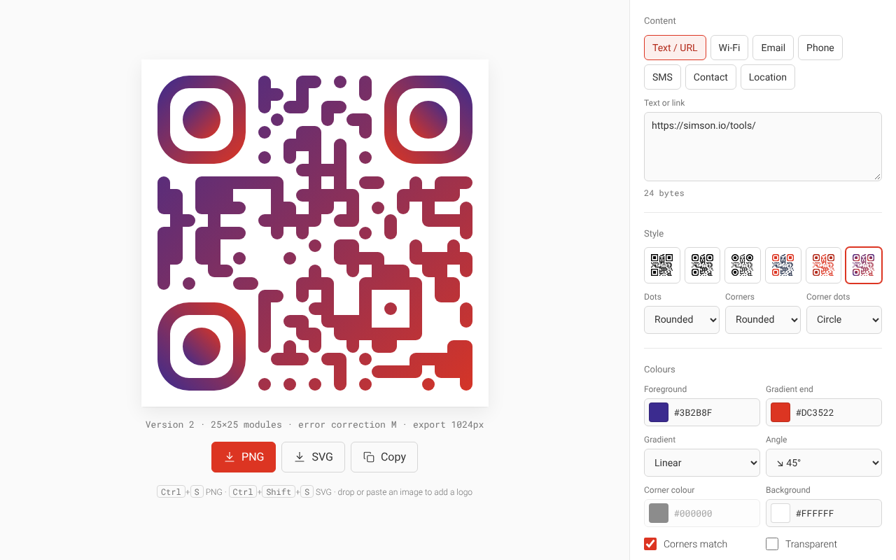

# QR Code Generator

Create QR codes for links, text, Wi-Fi networks, contacts (vCard), email, phone, SMS and locations. Style dots and corners, pick colours or gradients, add a logo in the centre (drop or paste an image) and export as PNG, JPEG, WebP or SVG at any size, or copy it to the clipboard.
