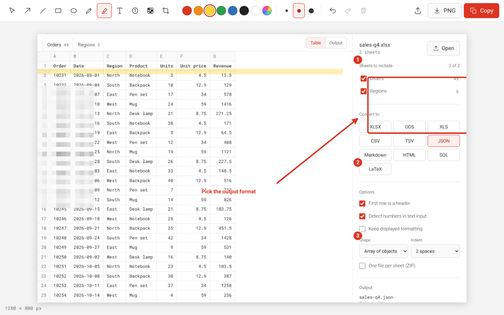

# Screenshot Annotator

Paste a screenshot (or drop/choose an image) and add arrows, fat highlight arrows, lines, boxes, ellipses, freehand pen and highlighter strokes, text, resizable numbered steps, and soft blur or pixelation for sensitive parts such as faces. An optional layers sidebar lists every item to select, hide, reorder or delete. Crop, then copy the result to the clipboard or download it as PNG. Everything is editable until export, with undo/redo and keyboard shortcuts for every tool.
