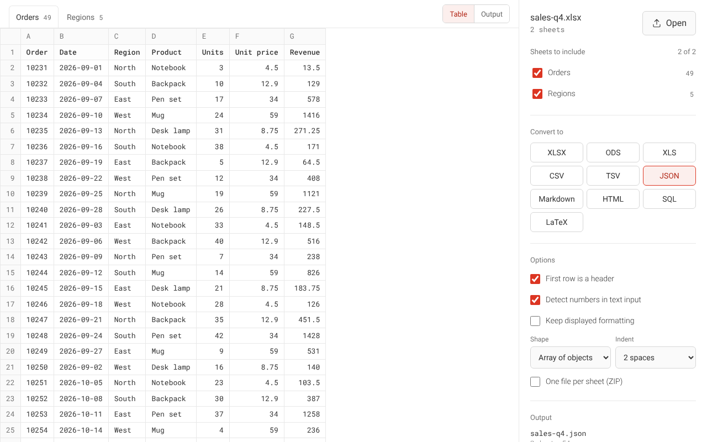

# Spreadsheet Converter

Drop, paste or choose spreadsheets (xlsx, xls, ods, numbers, csv, tsv, json, html, markdown) and convert them to XLSX, ODS, XLS, CSV, TSV, JSON, Markdown, HTML, SQL or LaTeX. Several files and sheets can be combined into one workbook, delimiters and encodings are detected automatically, and cells copied from Excel can be pasted directly. Replaces the old CSV to Excel converter.
