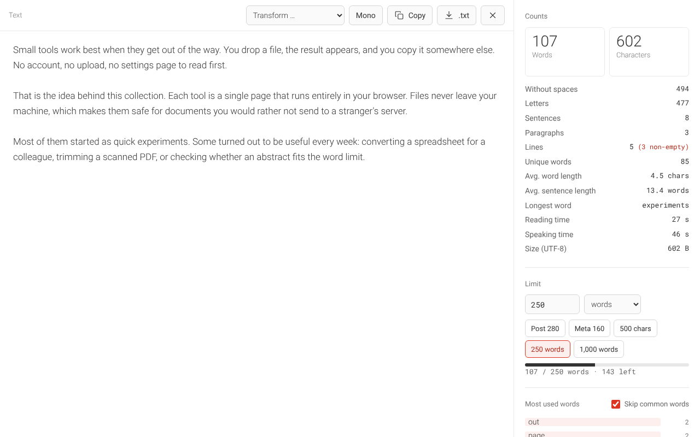

# Word & Character Counter

Type or paste text to see words, characters (with and without spaces), sentences, paragraphs, lines, unique words, reading and speaking time, and the most used words, live and for the current selection. Drop PDF, Word (.docx), ODT, HTML or plain-text files to extract and count their text. Includes character/word limits and quick text transforms.
